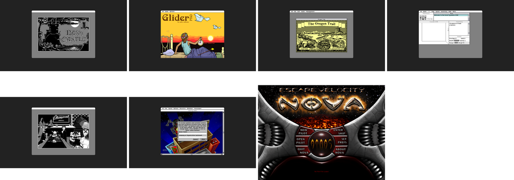

# Classic Mac Games

Seven classic 68k Macintosh games that run in a web browser. Play them at **[mac.statico.io](https://mac.statico.io)**.

There is no Apple ROM and no Mac system software. The emulator is [Executor](https://github.com/autc04/executor), which reimplements the Mac Toolbox in C++. We compile it to WebAssembly.



## The games

| Game | Version | Year | Made by | Publisher | Source |
|---|---|---|---|---|---|
| Scarab of Ra | 1.4 | 1987 | Rick Holzgrafe | Semicolon Software | [Macintosh Garden](https://macintoshgarden.org/games/scarab-of-ra) |
| Dark Castle | 1.1 | 1986 | Jonathan Gay (programming), Mark Stephen Pierce (design and art) | Silicon Beach Software | [Macintosh Garden](https://macintoshgarden.org/games/dark-castle) |
| The Oregon Trail CD | 1.2 | 1993 | MECC: Craig Copley and Wayne Studer (producers), Joan Clarke, Tom Naughton, Brian Nesse and Steve Splinter (programming), Dave Denninger, Charolyn Kapplinger and Mike Tschimperle (art), Larry Phenow (music and sound). The original 1971 game is by Don Rawitsch, Bill Heinemann and Paul Dillenberger. | MECC | [Macintosh Garden](https://macintoshgarden.org/games/the-oregon-trail-cd) |
| Shufflepuck Café | 14C (pre-release) | 1988 | Christopher Gross | Brøderbund | [Macintosh Garden](https://macintoshgarden.org/games/shufflepuck-cafe) |
| SimCity 2000 | 1.1 | 1993 | Will Wright, Fred Haslam and Maxis | Maxis | [Macintosh Garden](https://macintoshgarden.org/games/simcity-2000-v10-11) |
| Glider 4 | 4.06 | 1991 | John Calhoun | Casady & Greene | [Macintosh Garden](https://macintoshgarden.org/games/glider-40) |
| EV Nova | 1.0.2 | 2002 | Matt Burch and ATMOS | Ambrosia Software | [Macintosh Garden](https://macintoshgarden.org/games/escape-velocity-nova) |

Thank you to these authors for their work. Thank you also to the [Macintosh Garden](https://macintoshgarden.org/), which keeps abandoned Mac software available. [`web/credits.json`](web/credits.json) has the full credits, the copyright text from each game, and the archive checksums.

## How it works

1. **Executor** runs the game. Executor was a commercial Mac emulator from ARDI (1990). It does not emulate Mac hardware. It reimplements the Mac Toolbox (QuickDraw, the Window Manager, the File Manager and more) in C++. A 68k CPU emulator, syn68k, runs the game code. When the game calls a Toolbox trap, Executor runs its own C++ version of that call.
2. **Emscripten** compiles Executor to WebAssembly. [`scripts/build-executor-wasm.sh`](scripts/build-executor-wasm.sh) clones Executor at a fixed commit and applies our patches from [`patches/`](patches). The patches add a browser front end and fix the Toolbox calls that these games need.
3. **ASYNCIFY** lets the emulator loop give control back to the browser. Every time the emulated Mac waits for events, the page draws the screen and reads the mouse and keyboard.
4. **The game files** are packaged with Emscripten's `file_packager` into `web/executor/games/<game>.data`. The page mounts each package as a folder. Mac resource forks are stored in AppleDouble files. [`docs/executor-file-formats.md`](docs/executor-file-formats.md) describes the format.
5. **The page** [`web/executor/index.html`](web/executor/index.html) copies the emulated screen to a `<canvas>` on each frame. It sends browser mouse and key events to the emulator.
6. **The site** [`web/index.html`](web/index.html) shows the list of games and opens each game in an `<iframe>`.

Some fixes that the games needed:

- **SimCity 2000 and others:** a short browser click can end before the game reads the mouse. The front end holds the mouse-up until the game has read the mouse-down, for a maximum of 500 ms.
- **Oregon Trail CD:** one of its pictures has a region larger than 32 KB. Executor read the region length as a signed number, asked for a negative amount of memory, and the game reported that it had run out of memory. Executor now reads the length as unsigned. A picture in its first dialog also has junk bytes that make the parser read past its end. DrawPicture now stops at the end of the picture.
- **Files and math:** local folders accept range locks, and SANE extended-precision floats convert correctly on WebAssembly. The floppy version of Oregon Trail needed both.
- **Dark Castle:** the game stores flags in the high byte of pointers (24-bit addressing).
- **EV Nova:** it needed a small Display Manager, screen gamma calls, `GetProcessInformation`, `ParseSndHeader`, clipping for GWorlds larger than the screen, and a decoder for QuickTime "Animation" pictures.
- **Sound:** a small sound driver sends the Sound Manager mix, the old Sound Driver and the Mac Plus sound buffer at `SoundBase` to Web Audio. Browsers start sound only after a user action, so sound starts at the first click or key press in the game.

## Build it yourself

You need macOS or Linux, Python 3, `unar` and `hfsutils`.

```sh
scripts/build-executor-wasm.sh      # emsdk, Executor, patches, executor.{js,wasm}
scripts/fetch-games.sh              # download the archives from the Macintosh Garden
# then prepare and package each game: see games/README.md
cd web && python3 -m http.server 8642
```

Then open <http://localhost:8642/>. [`games/README.md`](games/README.md) gives the steps for each game.

Bundles larger than 50 MB (EV Nova and The Oregon Trail CD) are split into 45 MB parts, because GitHub and Vercel do not accept files larger than 100 MB. The page joins the parts again before it starts the game.

## Credits

- **The game authors** in the table above.
- **Executor:** ARDI (Abacus Research and Development, Inc.), Cliff Matthews, Mat Hostetter (syn68k), Cotton Seed, Bill Goldman, Patrick LoPresti, Joel Hunter, Sam Lantinga, Lauri Pesonen and Samuel Vincent. Cliff Matthews released Executor as open source in 2008 ([ctm/executor](https://github.com/ctm/executor)). Wolfgang Thaller modernized it as [Executor 2000](https://github.com/autc04/executor). MIT license.
- **[Emscripten](https://emscripten.org/)**, which compiles C++ to WebAssembly.
- **[Macintosh Garden](https://macintoshgarden.org/)**, the source of all the game archives.
- **Apple:** the floppy disk icon on the site is from Mac OS 8.1, by Apple. [`scripts/floppy-icon.py`](scripts/floppy-icon.py) takes it from the System file.
- **Claude Code** wrote the port, the patches and this site.

## Legal

These applications are the property of their respective owners. They are here for archival and historical purposes only. If you own the rights to one of these games and want it removed, [open an issue](https://github.com/statico/classic-mac/issues) and we will remove it.
